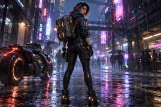
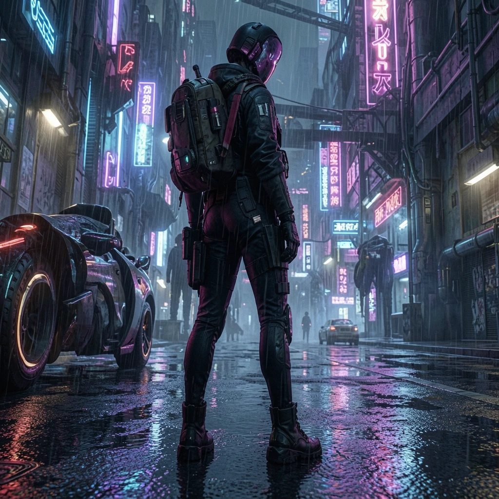

# 一张保存下来的游戏帧，怎样变成可核对的 DLSS 5 风格参考

风格转换让已有画面尝试另一种光照、配色和材质表达。把原图留在重绘结果旁边，逐项检查角色、服装与文字，才能判断哪些变化可以作为视觉参考。

## TL;DR

- 源图提供角色与构图，提示词描述想改变的视觉方向。
- 轮廓、服装结构、HUD 与文字是验收条件，不能因为结果好看就放宽。
- 本文真实样例来自本站原创合成角色，不冒充商业游戏截图。
- 这次缓存结果改变了人物特征，保留它是为了说明如何检查。

## 风格参考能帮你讨论什么

一张保存的画面已经包含姿势、机位、主体与背景的关系。重绘可以让你看看，同样的创作出发点换一种照明或材质处理，会形成怎样的视觉方向。它能把抽象的美术讨论落到可看的图上。

例如，你想讨论霓虹反射是否压过了深色服装，或者人物和背景的明暗关系是否适合目标氛围。参考图可以支持这样的讨论，却不能证明最终游戏会以相同方式渲染，也不能替代动画、资产制作与实际场景验证。

本站[游戏角色风格转换页](https://www.dlss5nvidia.com/game-character-style)承接的是独立图像重绘。这里的 DLSS 5 风格指向视觉参考方向，浏览器样例不等于运行或测试 NVIDIA 游戏运行时。Studio 可以承接工作流交付，风格转换这项能力本身才是本篇讨论的对象。

## 把要保留的角色与要改变的效果分开

### 先写清角色不能丢什么

观察角色外轮廓，再找几处能认出服装的结构。背包、外套开口、肩带的位置、头发外形，都可能比新增纹理更重要。把这些部位列进简报，检查时让它们始终能与原图对照。

「电影感光照」不等于同意换脸或重新设计装备。如果结果越过这条线，应记为偏离要求。你仍可以把新图当成另一个概念方向讨论，但不能悄悄把它当成原角色已经通过的转换版本。

### 把风格写成能看见的变化

风格可以具体到反射光颜色、亮面与暗面的过渡、表面粗糙感，或者人物与背景的色彩关系。这些内容可以逐项比对。描述希望改变哪一部分，也写清哪些部分要稳定。

很多互相竞争的效果堆在一起，会让验收很难下结论。更容易执行的做法是先确定视觉方向，再说明它应当体现在哪里。这是编辑与审核建议，不是「短提示词一定更好」的实验结论；本次真正使用的提示词已经随文件保存。

## 本次确实取得了什么

我们请求了公开 characterStyle 样例，保存成功响应，再下载其中指定的输入与返回图片。响应记录了提示词、输入地址、结果地址以及缓存状态。它证明本次取到了真实存储结果，没有证明当天重新跑过推理。

输入是本站原创合成的赛博朋克角色参考，没有来自某款商业游戏的录屏。固定提示词要求保持轮廓与服装，同时采用赛博朋克电影感光照、湿地面和霓虹反射，并要求不出现文字。



*图 1。实际下载的 characterStyle 输入，来源为本站 /examples/generated/game-cyber-1-before.jpg。许可为本站自有素材、本批次使用授权；它不是商业游戏捕获，也不是 NVIDIA 输出。*

输出仍保留雨夜霓虹街道与站立人物这一大方向，但熟悉的场景气氛不足以证明任务合格。原图能看见脸和头发，结果却画出了头盔，构图也发生变化。如果要求保留身份与轮廓，这些偏差就需要明确记录。



*图 2。公开样例接口实际返回的存储结果，run.json 中 cached 为 true。来源与许可为本站自有生成样例、本批次授权；本图展示的是带有保留失败的真实重绘，不是通过身份保真验收的案例。*

### 画面里的字也属于内容

虽然提示词要求不出现文字，结果仍有招牌形状的字符。我们不转录这些字符，也不推断它们忠实对应输入的招牌。画面里出现了文字样式，并不意味着这些字具备可核验含义。

这组样例没有游戏 HUD，所以不能证明 HUD 保留能力。对你自己有权使用的游戏帧，血量、计数器、字幕、菜单文字和按键提示都需要对原图逐项检查。要求准确文字时，生成近似字形仍然不合格。

## 复现本次取图与检查

下面是本篇实际执行过的公开请求和下载过程。在空目录中运行，先确保终端可用 curl。交付包保存了当次响应与文件哈希，方便区分本文版本和未来可能更新的缓存。

```sh
curl --fail --silent --show-error \
  -H 'Content-Type: application/json' \
  -d '{"sample":"characterStyle"}' \
  https://www.dlss5nvidia.com/api/image-edit/samples -o run.json
curl --fail --silent --show-error \
  https://www.dlss5nvidia.com/examples/generated/game-cyber-1-before.jpg -o input.jpg
curl --fail --silent --show-error \
  'https://www.dlss5nvidia.com/api/image-edit/samples?sample=characterStyle' -o output.webp
```

先读 run.json，若失败或尚未完成，就保留真实状态。样例更新后另存新文件，不要沿用旧图的日期和说明。哈希一致说明你查看的是同一文件，不能替代对提示词是否落实的判断。

本篇还复用了内容库的截图脚本，将这两份确切文件放在本地检查页里，实际执行并保存浏览器输出。脚本和记录随文交付；这个步骤复现的是查看方式，不是第二次生成。

### 按顺序做一次检查

1. 阅读保存的提示词，分别找出希望改变的效果与要求保留的内容。
2. 先同时看完整输入和输出，别一开始只选结果漂亮的局部。
3. 沿头部、肩膀、衣服外轮廓和装备对照。
4. 单独检查文字，不把文字正确性并入光照观感。
5. 保存判断时写具体偏差，不只写「好看」或「不好看」。

这些动作已用于本次图对。我们没有另外实测移除 HUD、恢复人脸或某个纠正提示词的保证效果。继续修改时，应另立输入、输出和审阅记录，而不能把后续设想写成已有成果。

## 一个混合结果可以怎么使用

一张参考图可以同时具备有启发的光照和不可接受的角色变化。分别记录两种判断，可能保留霓虹反射作为讨论材料，同时拒绝它作为原角色的忠实转换。图注应当说明仍然成立的用途。

不要裁掉改变的头部，只展示衣服，然后声称整个角色已经保住。局部图只能回答局部问题。做整体判断的人应当能看到完整输入与结果，包括不理想的区域。

交给后续创作者时，注明哪些光照或材质可作参考，哪些新增元素不得沿用。这样美术人员可以理解视觉方向，又不会顺手继承偶然生成的新设计。交付对象是可讨论的参考与明确简报，并非已经可直接进入游戏的资产。

## 提示词与参考资料的作用

Black Forest Labs 的[图像编辑文档](https://docs.bfl.ml/flux_2/flux2_image_editing)介绍了文本和图片参与编辑的一般方式。这里把它作为技术背景，不用它替本站样例证明效果，也不把它与 NVIDIA 渲染运行时混为一谈。

BFL 的[多参考说明](https://help.bfl.ai/articles/6546682167-what-is-multi-reference-editing)讨论不同参考图的内容分工。本次角色样例只有一张源图和固定提示词，没有验证加入第二张图会怎样，因此不编造双参考对比。

搜索 dlss 5 style conversion 的人应能同时看到变化方向和约束证据。dlss 5 style conversion 的实际价值，在于让视觉方向变得可以审阅；原图和任务简报仍然决定能不能接受结果。

## 边界与独立性

本篇不保证身份不变、HUD 准确、几何精确、商业资产可用、时序一致或游戏性能。我们记录的是一个缓存合成角色重绘及实际检查过程。本文链接本站自有工具；本站独立运营，与 NVIDIA、AMD、Black Forest Labs 无隶属关系，配图没有使用第三方作品。
