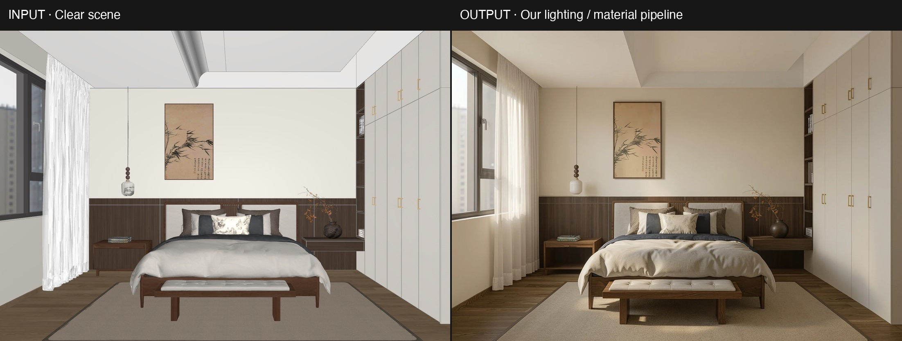
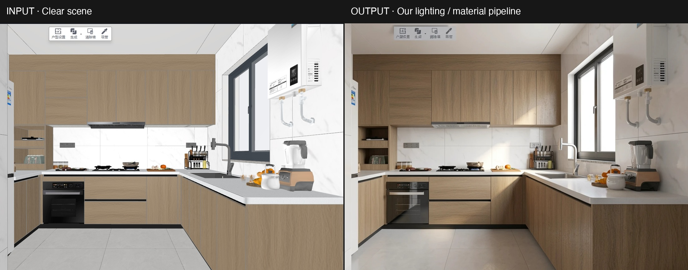

# 神经渲染重绘该看哪里：让风格参考带着清楚的使用边界

风格转换能把另一种光照和材质方向呈现在已有画面上。把小字、标识、身份与比例分开检查，才能保留参考价值，同时避免把重绘改动当成原始事实。

## TL;DR

- 想改变的视觉方向，与必须保留的内容分开验收。
- 完整输入和输出都留下，暂定或失败结果也不删。
- 先查文字、符号、身份线索和空间关系，再批准使用范围。
- 本文真实室内记录只支持具体图像观察，不建立普遍保真承诺。

## 先确定你在审什么变化

这份 neural redraw checklist 从创作任务出发。本文两组记录的目的，都是在已有室内效果图上重新解释光照与材质，同时让原来的空间安排保留在对照中，便于讨论新的视觉方向。

这属于 A 能力线：DLSS 5 风格转换与神经渲染重绘。有效成果可能是日光、间接照明、布料受光或表面对比的参考。能力不由桌面软件的包装定义，也不需要把生成房间说成真实空间的忠实照片。

本站[前后对比页](https://www.dlss5nvidia.com/before-after)提供查看图对的入口。本文补的是一套记录方式：结果哪些部分还能当参考，哪些内容不能直接带到最终设计里。边界说明只有进入具体使用决定，才真正有用。

## 这两组图背后有什么记录

卧室与厨房都来自 10 月 21 日实际完成的本站 flux-klein 任务。原始输入、返回输出、提示词与任务记录仍在。此次直接复制已有对照，不通过调色或改动内容来制造更明显的反差。

原审阅把它们列为带有偏差的光照方向候选，没有批准几何保真。这个状态随图保留。本文没有重新执行那些模型任务，也不会把接口 SUCCESS 写成视觉验收通过。

*图 1。10 月 21 日卧室任务保留的对照图，来源为本站 sample2 与真实 flux-klein 输出。许可为自有素材、本批次使用授权；原记录为 room-run.json。它是暂定光照参考，没有通过几何保真验收。*

房间大体仍然熟悉，但床品外观、挂画及部分柜体细节有变化。检查这些位置，比泛泛判断「还是同一个房间」更有用。熟悉的整体布局不能证明装饰图案或家具与建筑的关系完全保留。

## 小字要按内容检查

### 逐字看，别只看像不像文字

标题、电器标签、招牌和界面控件都传达信息。进入风格重绘后，它们也可能被当成画面纹理处理。因此要判断的是具体字符是否留下，而不是远看是否足够像一行文字。

厨房对照里可以看到上缘界面浮层和电器标记。我们没有从这张拼图认证小字内容。需要确认时，打开随包的完整文件，结合已知原文核对，不把生成后貌似可读的内容当成转录答案。

若某个字辨认不清，就写「无法核实」；这与确认字符发生变化不同。原图清楚的字变成另一字，才记录为观察到的不一致。检查表需要区分实际错误与证据不够的位置。

### 审阅说明留在生成画面之外

任务号和审阅结论放在独立文档里。如果把它们画进图片后又送去重绘，说明本身也会成为模型处理的对象。审计记录应当能够脱离图像中的文字独立阅读。

做展示时，可以在图外说明采用了什么视觉方向。不要让画面中一个生成标签替你证明产品名称或历史事实。即使排除文字的复用，图像仍可能适合讨论光照与材质。

## Logo 和符号要核内部结构

标志可能仍然能认出来，但字距、内部留白和比例已经改变。角色设计中的虚构徽章也是如此。对照有授权的原始设计，检查它的内部形状及周围空间，不只凭熟悉的颜色批准。

这两组室内图没有提供经过核验的品牌标志实验。Logo 检查是留给自身素材包含标识的读者使用的验收项，我们不拿无法认证的电器标签编出一次成功保留标志的结论。

生成出某种符号也不代表获得商业使用权。实际交付前保留来源，必要时让负责标识的权利人或设计者确认最终版本。这里给的是编辑审阅建议，没有作法律判定。

*图 2。10 月 21 日厨房任务的既有对照，原样复制。来源为本站 sample1 与实际 flux-klein 输出，许可为自有；kitchen-run.json 保存请求记录。小字、水龙头和电器外形仍需复核，不能当作已经批准的忠实空间呈现。*

## 身份要单独验收

认出一个人或角色，并不只靠外轮廓。脸形、发际线、表情、个人标记与服装结构都可能参与识别。编辑者觉得很小的改动，被拍摄者或角色设计师可能一眼就会发现。

本文室内图没有人脸，所以不能证明身份保留，也不能用来判断人像工具的表现。处理有授权的人像，应始终与原图对照，并在把结果当作本人形象使用前，请本人参与确认。

是否喜欢渲染效果与身份是否合适，是两个问题。你可以喜欢光线，同时拒绝被改动的表情。对于虚构角色，头盔、徽章、发型和衣服接缝也可能承担同样的识别作用。

## 精确比例不能靠可信观感决定

一张房间图看起来合理，长凳大小、柜门接缝或窗与墙的关系仍可能漂移。透视像真的，不证明家具放得下。只要决策涉及实际尺寸，就需要在生成图之外保留测量信息。

卧室记录要求保留空间安排，但原审阅仍指出挂画、枕头花纹、柜门布局和部分比例有变化。可以保留它对光照讨论的帮助，同时明确它不足以证明几何准确。

不要把这个观察改写成几何准确率。本次没有校准机位、测量场景或执行数值配准实验。可核实的是图像对照和具体疑点，这些已经足以说明更强的精确几何主张尚未建立。

## 复现我们实际执行的审阅

1. 打开 room-run.json 与 kitchen-run.json，读原始任务描述和完成记录。
2. 完整输入与返回输出并排看。包内既保留拼图，也保留独立源文件。
3. 对照卧室挂画、床品和柜体线条，再查看厨房界面浮层、水龙头和电器轮廓。
4. 把直接观察与未核实的小字、未测试的人脸及标志分开记录。
5. 决定每张图是否还适合作为视觉方向参考，以及哪些元素不得沿用。

我们还复用了库中的 reproduce-capture.mjs，把已有对照放入本地页面并实际截取浏览器画面，保留执行日志与 manifest。这个过程复现的是检查界面，没有制造新的推理结果，更没有模拟一次保真成功。

打开 assets/audit.html 就能看到相同的内嵌对照。若要重复截图，按 assets/README.md 配置浏览器与模块路径，在素材目录执行附带脚本。本包已经跑过该脚本；另做模型实验则需要独立请求与结果，不属于这次回放。

## 写出别人能使用的决定

一条审阅记录应说明想改变什么、看了哪里、观察到什么、允许用来做什么。对卧室图，可以讨论材质响应，同时保留装饰和几何方面的疑问。笼统盖一个「通过」会丢掉这些具体信息。

文字可以分成与原文核对一致、观察到不一致、清晰度不足以核实。身份要区分本人确认与编辑者印象。比例则区分观感检查和测量。这些标签描述的是证据，不要求所有创作共用一个阈值。

这份 neural redraw checklist 为继续创作服务。结果在某个条件下不合格，仍可能诚实地适合另一个用途，前提是接收者能看到限制。重新说明用途可以，隐藏失败不能代替审阅。

## 技术背景与边界

BFL 的[图像编辑说明](https://docs.bfl.ml/flux_2/flux2_image_editing)介绍文本参与编辑，[多参考说明](https://help.bfl.ai/articles/6546682167-what-is-multi-reference-editing)讨论多个参考内容的组合。它们提供背景，不是对本次输出的独立验证；本文没有使用这些页面的图片。

使用 neural redraw checklist，也不能保证文字、标志、身份、比例、商业适用性或时序稳定。本文讨论独立静态风格转换，不是 NVIDIA 运行时效果。我们运营落点站点，与 NVIDIA、AMD、Black Forest Labs 无隶属关系；每次审阅都应保留原始文件。
