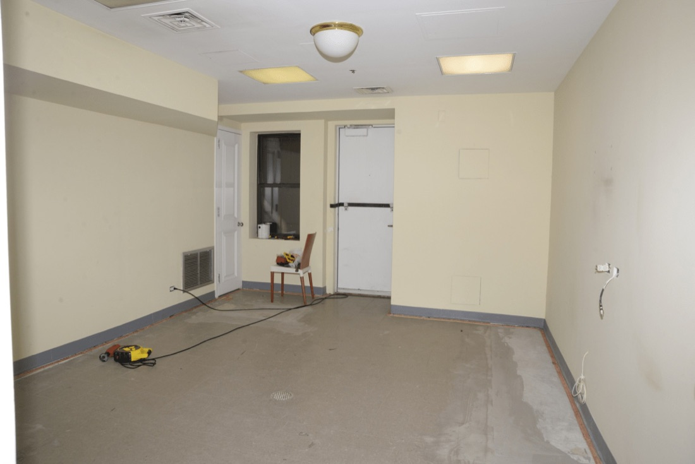
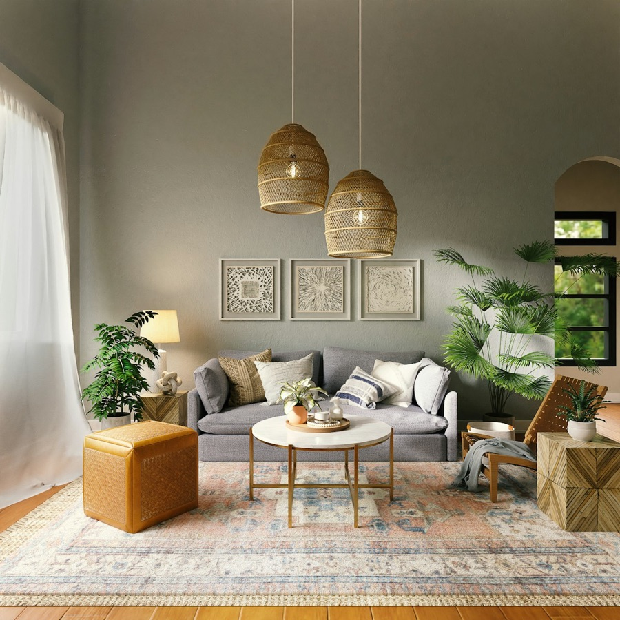
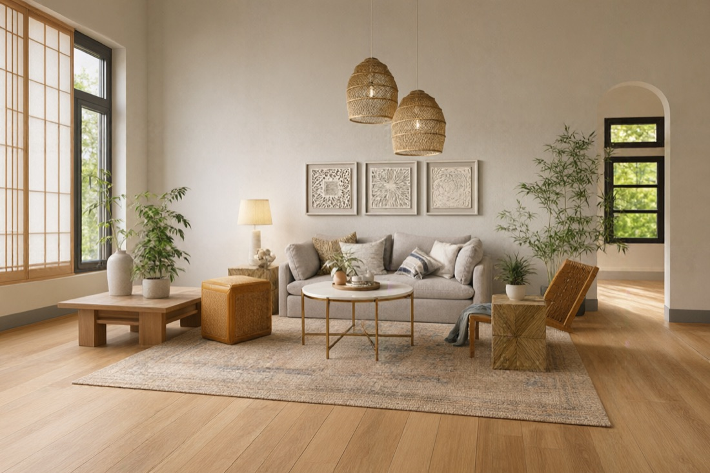

# Source image and style reference: give a room redraw a visual direction

A source image and style reference let you describe a room transformation with both an existing space and a desired visual language. Use the first to judge what should remain, and the second to discuss palette, materials, and atmosphere.

## TL;DR

- The room source supplies the space you intend to reinterpret; the reference supplies a visual direction.
- The current room tool uses named style and room settings, with an optional extra instruction, rather than an unrestricted prompt box.
- The existing FAQ warns that geometry can drift. It does not publish a guaranteed prompt-versus-reference priority rule.
- The historical example below changes architecture. Our new submission remains queued and is not represented as another successful result.

## Why this belongs to style conversion

A room redraw can turn a photograph into a concept for a different material and lighting treatment. The creative question is how the room might read under that direction. The result helps someone discuss a visual intention, while the photograph remains available to check what was changed along the way.

Our [interior-design page](https://www.dlss5nvidia.com/interior-design) is the relevant starting point because the actual samples are interiors. This is the A line of DLSS 5-style conversion and neural-render redraw. Studio is a delivery form; the transformation itself is the subject of this article.

The second image makes a brief more concrete when words such as warm, restrained, or natural could describe very different rooms. It may convey relationships between wood, fabric, wall color, and light. It should not be treated as a hidden specification for dimensions, a furniture shopping list, or an instruction to replace the photographed architecture.

## Give the two images different jobs

### The source establishes the room to review

Look at the first image before choosing a reference. Identify the wall openings, camera direction, ceiling line, and usable floor area. These become preservation criteria. If the output later changes them, a pleasing color treatment does not cancel the discrepancy.

The site's input below is an empty room with a door on the rear wall, a dark opening beside it, and visible equipment on the floor. Those observations are sufficient for comparing structure. We have not measured the room or inferred dimensions from the photograph.

*Figure 1. Source copied unchanged from the site's /examples/interior-room.jpg. License: own, as designated in the project's asset instructions. It is the first image in the recorded submission, not a floor plan or a measured architectural survey.*

### The reference communicates the treatment

The second image shows a furnished interior with woven pendant shades, a grey sofa, light-colored textiles, plants, and wood surfaces. A reviewer can point to those features instead of assuming that a style name carries the same meaning for everyone involved.

Assigning that role does not prove the model will respect its limits. The site's showcase describes the second reference as guidance for palette and materials. That is the intended workflow, not a physical constraint on generation. The output still needs comparison against the source room.

*Figure 2. Exact second input, copied from /examples/interior-style-ref.jpg under the project's own-sample authorization. It provides a visual reference; no separate ownership or commercial-use rights in depicted furniture designs are asserted.*

## What the text controls actually do here

The current interior workflow accepts a named style and a room type. In our submitted request these were Japandi and living room. The implementation can also append an optional extra instruction to its fixed brief. We left that optional field absent, so we cannot report an experiment about its strength.

This distinction matters when discussing prompts. A general image editor may expose a free-form prompt, but the specific room interface supplies structured choices. Saying that we typed a long custom prompt into this run would misdescribe the experiment. The recorded request contains only the fields that were actually submitted.

Text tells the workflow which direction or constraint the user wants to express. A reference image supplies visual content that can make a direction less ambiguous. Those are complementary roles in a brief; they are not measured weights, and we have no slider value or formula that establishes how much either one controls this model.

For general background, BFL's [image-editing documentation](https://docs.bfl.ml/flux_2/flux2_image_editing) discusses editing with textual and image inputs. Its [multi-reference explanation](https://help.bfl.ai/articles/6546682167-what-is-multi-reference-editing) describes combining reference content. These sources explain the broader concept, not the exact conflict behavior of the site's room model.

## If text and reference disagree, what wins?

The checked interior FAQ does not specify a winner. Its relevant answer says the workflow requests preservation of room geometry, while warning that generative results may drift and asking the reader to review openings, straight lines, and perspective. We cannot turn that answer into a guarantee that text always wins or that the second image always wins.

For example, the presence of an arch in a reference should not be read as permission to claim that the source room has one. If the generated room introduces that arch, compare it against the source and the intended brief. The result may remain a mood reference while failing the requirement to preserve the photographed space.

As an editorial practice, resolve contradictory requirements before accepting an image. Write down which architectural features must remain and which visual features are inspirations. This is a review recommendation, not a newly invented model priority rule or a claim that we tested every conflicting combination.

## What the historical example actually shows

The site's stored showcase links these two inputs to a Japandi output and records the named choices. We copied that existing output below. We do not label it as the result of today's queued request, and we do not repeat the showcase's timing or dimension fields as freshly measured facts.

*Figure 3. Existing /examples/interior-ref-after.jpg, copied unchanged from the site-owned showcase. Its historical association is recorded in historical-showcase.txt. This is not the output of the new queued task and is not evidence of exact architectural preservation.*

The output visibly adopts furnishings and a material mood related to the reference. It also shows a large left window and an arched opening on the right, unlike the rear-door arrangement in the source. That difference prevents us from presenting the pair as a successful geometry-preserving transformation.

The original showcase description is more confident about preserved architecture than this visual comparison supports. We retain the source record but do not repeat that assertion as our conclusion. Looking at the actual pair is precisely why a source image and style reference should travel with the resulting concept.

## Reproduce the steps that were actually performed

1. Copy the site's room and style-reference files into separate, clearly named inputs; our exact copies and hashes are included.
2. Upload the room first and the style image second to the existing interior-quality workflow.
3. Submit the recorded style and room type. Our request uses japandi and living_room, with no custom prompt, seed, or output dimensions.
4. Save the task identifier and inspect its status. The last saved status for this new task is QUEUED; it supplies no completed output for review.
5. Separately open the historical input, reference, and output together to inspect the differences described above.

The request record substitutes local filenames for uploaded image identifiers so the role and order remain understandable without presenting temporary upload references as durable assets. The task record preserves the actual job identifier. Repeating an authenticated submission may consume service credits and cannot promise identical output.

We also ran the existing content-library capture script on a local inspection page containing the stored images. Its actual execution log and file manifest accompany the package. That replay reproduces a comparison surface; it neither advances the queued job nor manufactures a successful generation record.

## Hand over the useful parts of the concept

For a room presentation, state what the image contributes: perhaps the relationship between muted walls and woven lighting, or the appearance of natural materials together. Keep the source room nearby and name any architectural departures. The recipient can then use the concept without mistaking it for a proposed measured layout.

A source image and style reference are also useful evidence when a result goes wrong. They let another reviewer see whether a disputed feature belonged to the original space, the inspiration image, or the generated interpretation. Without those inputs, a correction request can become a debate about an undocumented intention.

This example says nothing about commercially usable clothing replacement or face replacement. It contains no identity test. If your own authorized images include a person, review the face and identity with that person before accepting the result; a successful-looking room conversion would provide no evidence about that separate task.

## Limits and independence

This workflow cannot certify dimensions, unchanged architecture, furniture fit, identity, commercial suitability, or a universal prompt-reference precedence rule. The FAQ's concept-versus-measurement boundary remains applicable. We operate the linked site and are independent of NVIDIA, AMD, and Black Forest Labs. These are site-owned samples for static style-conversion discussion, not NVIDIA runtime screenshots or third-party product test images.
